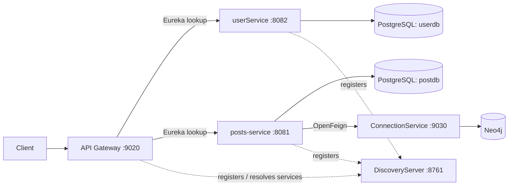

# LinkClub

LinkClub is a backend for a social networking application. It is organized as a set of Spring Boot services for account authentication, posts and likes, and user connections. An API Gateway provides an entry point and Eureka provides service discovery.

This repository is a backend project built to demonstrate Java service development and distributed application concepts. It does not currently include a frontend.

## Highlights

- **Microservice structure:** separate services for identity, posts, and connections, with gateway and registry applications.
- **Authentication flow:** user registration and login, BCrypt password hashing, signed JWT issuance, and gateway-side JWT parsing for protected user routes.
- **Social features:** create and retrieve posts, list posts for a user, and like or unlike a post.
- **Relational and graph persistence:** PostgreSQL with Spring Data JPA for users, posts, and likes; Neo4j with Spring Data Neo4j for connection records.
- **Service-to-service calls:** the posts service uses OpenFeign to request first-degree connections from the connection service.
- **API error handling:** posts service maps not-found and bad-request errors to structured error responses.

## Architecture



### Services

| Component | Responsibility | Default port |
|---|---|---:|
| `APIGateway` | Spring Cloud Gateway routes requests and applies a JWT authentication filter to user API routes. | 9020 |
| `DiscoveryServer` | Eureka registry for service registration and discovery. | 8761 |
| `userService` | Sign up, log in, store user accounts, hash passwords, and issue JWTs. | 8082 |
| `posts-service` | Create and retrieve posts; manage likes; call the connection service. | 8081 |
| `ConnectionService` | Retrieve a user's first-degree connections from Neo4j. | 9030 |

## Technology

- Java 17
- Spring Boot and Spring Web MVC
- Spring Cloud Gateway, Netflix Eureka, and OpenFeign
- Spring Data JPA / Hibernate and PostgreSQL
- Spring Data Neo4j and Neo4j
- JJWT for JWT creation and verification
- jBCrypt for password hashing
- Maven Wrapper in each service

## API overview

The paths below are based on the controller mappings in the source. User paths include the `/api/v1/user` servlet context path. The posts service currently has no configured servlet context path.

| Method | Path | Purpose |
|---|---|---|
| `POST` | `/api/v1/user/auth/signup` | Register with `name`, `email`, and `password`; responds with a user DTO. |
| `POST` | `/api/v1/user/auth/login` | Authenticate with `email` and `password`; responds with a JWT string. |
| `GET` | `/api/v1/user/auth/profile` | Return a profile response using the `X-User-Id` request header. |
| `POST` | `/core` | Create a post with a `content` field. |
| `GET` | `/core/{postid}` | Fetch a post by ID. |
| `GET` | `/core/users/{userid}/getallposts` | List posts for a user. |
| `POST` | `/likes/{postId}` | Like a post. |
| `DELETE` | `/likes/unlike/{postId}` | Remove a like. |
| `GET` | `http://localhost:9030/connections/core/{userId}/first-degree-users` | Fetch first-degree connections directly from the connection service. |

Example signup request:

```json
{
  "name": "Alex Example",
  "email": "alex@example.com",
  "password": "change-me"
}
```

Example post request:

```json
{
  "content": "Hello from LinkClub"
}
```

For gateway requests to the protected user routes, the authentication filter expects `Authorization: Bearer <token>`. The gateway exempts the signup and login paths and, on other routed user paths, verifies the signed token and forwards its subject as `X-User-Id`.

## Data model

- **User** (`userdb`): generated ID, name, unique email, and BCrypt-hashed password.
- **Post** (`postdb`): generated ID, content, owner user ID, and creation timestamp.
- **PostLikes** (`postdb`): generated ID, user ID, post ID, and creation timestamp.
- **Person** (Neo4j): graph node with a generated ID, application user ID, and name. The connection repository queries `CONNECTED_TO` relationships between `Person` nodes.

## Running locally

### Prerequisites

- JDK 17
- PostgreSQL with databases named `userdb` and `postdb`
- Neo4j available at `neo4j://127.0.0.1:7687`
- Maven Wrapper scripts are included in each service directory

Configure database usernames, passwords, and the JWT signing key through local configuration or environment overrides before starting. Do not commit credentials or production signing keys. The checked-in properties currently contain local credential values; rotate them if they have ever been used outside a disposable development environment.

### Start services

Open a separate terminal for each service. From the repository root, run the matching command:

```bash
./DiscoveryServer/mvnw -f DiscoveryServer/pom.xml spring-boot:run
./userService/mvnw -f userService/pom.xml spring-boot:run
./posts-service/mvnw -f posts-service/pom.xml spring-boot:run
./ConnectionService/mvnw -f ConnectionService/pom.xml spring-boot:run
./APIGateway/mvnw -f APIGateway/pom.xml spring-boot:run
```

Start the registry and data stores before the dependent services. The gateway and services use `localhost` for Eureka and database addresses in their current local configuration. The Gateway actuator configuration exposes health and gateway endpoints; Discovery Server also provides the Eureka dashboard at `http://localhost:8761`.

## Project layout

```text
APIGateway/       Gateway routes, authentication filter, JWT parsing
ConnectionService/ Neo4j connection lookup API
DiscoveryServer/  Eureka registry
posts-service/    Posts, likes, PostgreSQL persistence, Feign client
userService/      Registration, login, JWT issuance, PostgreSQL persistence
```

## Current implementation notes

This section describes the code as it exists in the repository, including areas a reviewer may want to explore further:

- The posts and likes service methods currently use a fixed user ID (`1L`) when creating posts or likes. User identity is not yet wired through those write operations.
- The connection repository query currently filters on a hard-coded user ID (`2`) instead of using its `userId` argument. The endpoint therefore does not yet provide a true per-user lookup.
- The connection controller is mapped under `/connections/core/...`, while the posts service Feign client requests `/connections/{userId}/...`; these paths currently do not line up, so the cross-service lookup needs route alignment.
- The gateway defines user and posts routes, but the posts route prefix (`/api/v1/post/**`) does not match the posts controllers' current `/core` and `/likes` mappings. Verify and align routing before using the gateway as the public entry point for those endpoints.
- The posts service calls the connection service when fetching a post, but the returned connection list is not currently used to filter or enrich the response.
- Test source currently includes Spring context-load checks and a Neo4j repository save test. It does not yet cover API contracts, authentication edge cases, or end-to-end service flows.
- `spring.jpa.hibernate.ddl-auto=update` is configured for local development. A production deployment should use managed migrations and externalized secrets/configuration.

## Backend engineering scope

LinkClub provides concrete discussion points for a backend interview: service boundaries, API gateway behavior, service discovery, relational versus graph data modeling, JWT-based identity propagation, password hashing, Feign-based service calls, persistence repositories, and the work required to make a distributed system production-ready.

## License

No license file is currently included. Add a license before redistributing the project.
